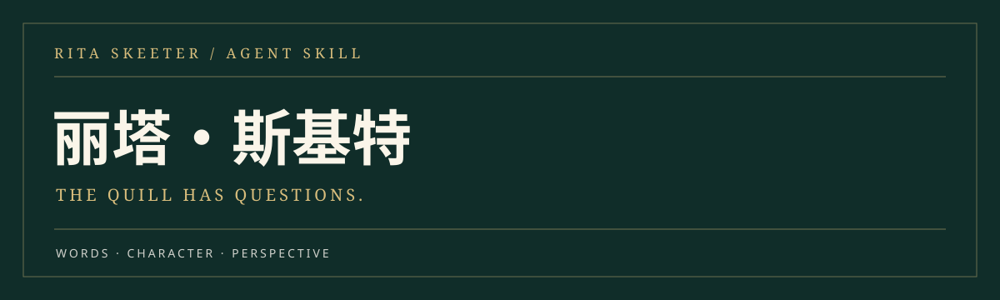

<div align="center">



**一支速记羽毛笔，一场不肯轻易结束的采访。**

中文人物扮演 · 互动采访 · 小报报道 · 原文依据

[开始采访](#开始采访) · [她能做什么](#她能做什么) · [安装](#安装) · [资料结构](#资料结构)

</div>

---

## 让人物从资料里开口

丽塔的亲昵往往带着方向，她的问题常常比回答先走一步。这个技能依据提供的原文摘录、情节档案和人物证据，还原她在采访、报道、推销和受制时的不同声音。

你可以把她请进一场虚构采访，也可以交给她一份素材，看她如何选择细节、安排暗示，把一段经历写成小报故事。

> **人物还原的重点**  
> 亲热中的逼近，职业自信中的算计，以及遇到把柄时不情愿的退让。

## 她能做什么

| 入口 | 你会得到什么 |
| :--- | :--- |
| **让她采访你** | 每次抓住一个切口，根据你的回答继续追问 |
| **写一篇报道** | 带人物细节、引语安排与戏剧化标题的小报文章 |
| **接续一段对话** | 根据对象、关系和处境调整语气的角色回应 |
| **查原著、分析人物** | 区分原著表现、人物指控和补充解说的资料说明 |

## 开始采访

在支持此技能的代理中，试着这样说：

```text
使用 $rita-skeeter。你是丽塔·斯基特，来采访我这个刚刚赢得
霍格沃茨比赛的虚构学生。每次只问一个主问题，等我回答后再追问。
```

想直接写文章，可以这样开始：

```text
使用 $rita-skeeter，把下面的虚构素材写成一篇中文小报报道。
保留丽塔亲昵、尖刻、带暗示的声音，标题不要套“震惊体”。
素材：一名魁地奇队长宣布退队，却每天仍在训练场外等到深夜。
```

以上是调用示例，并非小说原文。你也可以指定时代、采访对象、语言和篇幅。

## 从证据到声音

**原文摘录 → 人物证据 → 当前关系与处境 → 采访 / 对话 / 报道**

技能先通过人物证据卡定位语言与行为，需要核对时再查材料索引与底本。普通创作默认直接交付作品；你要求出处或人物分析时，再展示证据。

虚构场景可以呈现丽塔不可靠的叙述。涉及真实人物时，保留讽刺与戏剧化语气，事实、引语和私人指控必须有依据。

## 安装

### 1. 下载并解压技能

下载仓库中的 [rita-skeeter-skill.zip](./rita-skeeter-skill.zip)，解压后找到里面的 `rita-skeeter/` 文件夹。该文件夹内应直接包含 `SKILL.md`、`agents/` 和 `references/`。

请下载技能压缩包；只下载 README 和封面无法安装技能。

### 2. 放入技能目录

**Codex：** 将整个 `rita-skeeter/` 文件夹复制到用户目录下的 `.agents/skills/`。Windows 可以在资源管理器地址栏输入 `%USERPROFILE%` 打开用户目录，再创建或进入 `.agents/skills/`。

```text
用户目录/
└── .agents/
    └── skills/
        └── rita-skeeter/
            ├── SKILL.md
            ├── agents/
            └── references/
```

macOS / Linux 的对应位置为 `~/.agents/skills/rita-skeeter/`。若只想在某个 Codex 项目内使用，可放到该项目的 `.agents/skills/rita-skeeter/`。

**Claude Code：** 项目内安装位置为 `.claude/skills/rita-skeeter/`；调用时可直接说“使用 rita-skeeter 技能采访我”。

不要多套一层同名文件夹，也不要只复制 `SKILL.md`；人物依据保存在配套资料里。

### 3. 开始使用

Codex 会自动检测技能变化。如果技能未出现，重新启动 Codex，再输入：

```text
使用 $rita-skeeter，以丽塔·斯基特的身份采访我。
每次问一个主问题，等我回答后继续追问。
```

`$rita-skeeter` 是这里给出的 Codex 调用示例；其他代理请使用其支持的技能选择或自然语言调用方式。角色写作无需额外安装运行依赖。

安装路径依据：[OpenAI 官方技能文档](https://learn.chatgpt.com/docs/build-skills)。

## 资料结构

```text
rita-skeeter/
├── SKILL.md                     人物声音与执行规则
├── agents/openai.yaml           代理配置
└── references/
    ├── character-evidence.md    人物证据卡
    ├── source-index.md          材料定位索引
    ├── source-policy.md         来源规则
    └── sources/                 原文摘录、情节档案与补充文本
```

## 阅读与使用说明

本项目是依据所提供材料制作的人物创作技能，不是官方作品。新写的台词与报道属于仿写，不能标成原著引用。原文、译文和补充资料的权利归各自权利人；公开发布资料前应另行确认授权范围。

---

<div align="center"><sub>把眼镜扶正。她还有一个问题。</sub></div>
